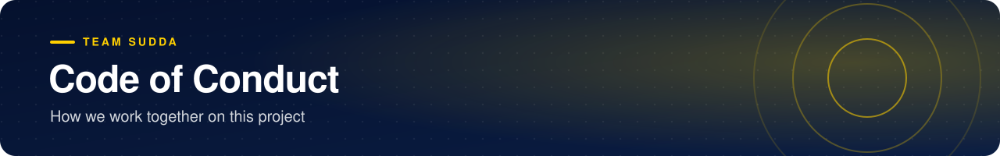

 

<strong>Everyone who works on this project deserves a professional, respectful and harassment-free environment.</strong>

---

## Our commitment

Everyone taking part, including staff, partners and invited collaborators, is treated with respect regardless of background, identity or experience. This code applies to every project space: this repository, its issues, pull requests and discussions, and anyone representing the project elsewhere.

<a href="#top">Back to top ↑</a>

## Standards

<table>
<tr>
<th width="50%">We expect</th>
<th width="50%">We do not accept</th>
</tr>
<tr>
<td valign="top">
<ul>
<li>Respect and consideration in issues, pull requests, reviews and messages</li>
<li>Constructive feedback that critiques the work, not the person</li>
<li>Assuming good intent, and asking before assuming</li>
<li>Confidentiality of team discussions, unreleased designs, customer data and credentials</li>
<li>Owning mistakes and helping put them right</li>
</ul>
</td>
<td valign="top">
<ul>
<li>Harassment, insults, or discriminatory or demeaning language</li>
<li>Personal or political attacks</li>
<li>Publishing others' private information without permission</li>
<li>Sharing confidential project material without authorisation</li>
<li>Any conduct inappropriate in a professional workplace</li>
</ul>
</td>
</tr>
</table>

<a href="#top">Back to top ↑</a>

## Reporting

> [!NOTE]
> Report concerns to **[hello@teamsudda.lk](mailto:hello@teamsudda.lk)**. Every report is reviewed promptly and handled in confidence, and the person reporting is protected from retaliation.

| Step  | What happens                                                         |
| :---: | -------------------------------------------------------------------- |
| **1** | You report what happened, with links or screenshots if you have them |
| **2** | A maintainer acknowledges the report and reviews it in confidence    |
| **3** | The maintainer decides on a response and tells you the outcome       |

<a href="#top">Back to top ↑</a>

## Enforcement

Maintainers may remove, edit or reject contributions that breach this code, and may restrict or remove access. Responses are proportionate:

| Response                  | Typical use                                                      |
| ------------------------- | ---------------------------------------------------------------- |
| **Correction**            | A private note explaining the problem and the expected behaviour |
| **Warning**               | A formal warning, with consequences for further breaches         |
| **Temporary restriction** | Loss of access to project spaces for a set period                |
| **Removal**               | Permanent loss of access for serious or repeated breaches        |
