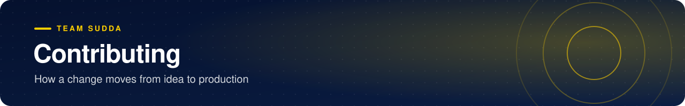
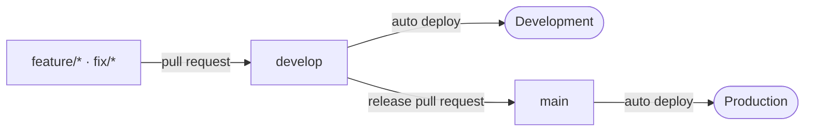

<a id="top"></a>

<div align="center">



<br/>

<p><strong>Thanks for helping build the teamsudda.lk maintenance fallback. This guide is the single source of truth for how work is planned, built, reviewed and released.</strong></p>

<a href="README.md"></a>
<a href="CONTRIBUTING.md"></a>
<a href="CODE_OF_CONDUCT.md"></a>
<a href="SECURITY.md"></a>
<a href="CHANGELOG.md"></a>
<a href="LICENSE.md"></a>

</div>

---

> [!NOTE]
> This repository is private and its source code is proprietary (see [LICENSE](LICENSE.md)). Code contributions are accepted from Team Sudda team members and invited collaborators only. Anyone is welcome to report a bug or suggest a change by opening an issue.

<details>
<summary><strong>Contents</strong></summary>

1. [Workflow at a glance](#workflow-at-a-glance)
2. [Branches and environments](#branches-and-environments)
3. [Naming branches](#naming-branches)
4. [Commit messages](#commit-messages)
5. [Pull requests](#pull-requests)
6. [Code standards](#code-standards)
7. [Documentation and decisions](#documentation-and-decisions)
8. [Releases](#releases)
9. [Getting help](#getting-help)

</details>

## Workflow at a glance

| Step  | What to do                                                         | Done when                                 |
| :---: | ------------------------------------------------------------------ | ----------------------------------------- |
| **1** | Open or pick an issue, using the bug report or change request form | The problem and expected result are clear |
| **2** | Branch from `develop` with a type prefix                           | A short-lived branch exists               |
| **3** | Make the change and run the checks locally                         | Every check passes                        |
| **4** | Open a pull request into `develop` and complete the checklist      | CI is green and the change is reviewed    |
| **5** | Squash and merge                                                   | The change deploys to development         |
| **6** | Release by pull request from `develop` into `main`                 | The change deploys to production          |

```sh
bun run format:check && bun run test && bun run check
```

<p align="right"><a href="#top">Back to top ↑</a></p>

## Branches and environments



| Branch                 | Environment | Purpose                                                | Lifetime            |
| ---------------------- | ----------- | ------------------------------------------------------ | ------------------- |
| `main`                 | Production  | Released code only                                     | Permanent           |
| `develop`              | Development | Integration branch; every merge deploys to development | Permanent           |
| `feat/*`, `fix/*`, ... | None        | One change each, merged into `develop`                 | Deleted after merge |

> [!IMPORTANT]
> Never push directly to `develop` or `main`, and never force-push to either. Every change arrives through a pull request.

<p align="right"><a href="#top">Back to top ↑</a></p>

## Naming branches

| Prefix     | Use for                              | Example                     |
| ---------- | ------------------------------------ | --------------------------- |
| `feat/`    | New features, screens or pages       | `feat/online-payments`      |
| `fix/`     | Bug fixes                            | `fix/booking-date-timezone` |
| `content/` | Copy, imagery or articles            | `content/monsoon-care-post` |
| `style/`   | Visual or design changes             | `style/footer-spacing`      |
| `chore/`   | Dependencies, tooling, configuration | `chore/upgrade-vite`        |
| `docs/`    | Documentation                        | `docs/deployment-guide`     |

<p align="right"><a href="#top">Back to top ↑</a></p>

## Commit messages

Commits follow [Conventional Commits](https://www.conventionalcommits.org):

```text
<type>(<optional scope>): <summary in the imperative mood>
```

| Type       | Meaning                                | Type      | Meaning                                          |
| ---------- | -------------------------------------- | --------- | ------------------------------------------------ |
| `feat`     | A new feature                          | `style`   | Visual or formatting change, no behaviour change |
| `fix`      | A bug fix                              | `content` | Copy, imagery or article content                 |
| `perf`     | A performance improvement              | `docs`    | Documentation only                               |
| `refactor` | Restructure without changing behaviour | `test`    | Adding or updating tests                         |
| `ci`       | Workflows and pipelines                | `chore`   | Build, tooling or dependencies                   |

<details>
<summary><strong>Good and bad examples</strong></summary>

| Good                                              | Why it is not                                 |
| ------------------------------------------------- | --------------------------------------------- |
| `feat(booking): let customers pick a time window` | `update booking` (no type, vague)             |
| `fix(invoice): round totals to the nearest cent`  | `fixed bug` (no scope, no detail)             |
| `docs(deploy): document the rollback steps`       | `docs: Updated the docs.` (past tense, vague) |

</details>

<p align="right"><a href="#top">Back to top ↑</a></p>

## Pull requests

Every pull request uses the template and must satisfy this checklist before merge:

- [ ] CI is green (the same checks as above)
- [ ] Every live hostname is re-tested after the change (`curl -sI https://<host>/`)
- [ ] No secrets, credentials or personal data are added
- [ ] Documentation is updated in the same pull request
- [ ] `CHANGELOG.md` has an entry under `Unreleased` for user-facing changes

> [!TIP]
> Keep pull requests small and focused. One change per pull request is reviewed faster and rolls back cleanly.

<p align="right"><a href="#top">Back to top ↑</a></p>

## Code standards

<table>
<tr>
<td width="50%" valign="top"><strong>No runtime dependencies</strong><br/>The Worker uses web-standard APIs only, so it keeps working when everything else is down.</td>
<td width="50%" valign="top"><strong>Formatting</strong><br/>Prettier is the source of truth. Format before committing.</td>
</tr>
<tr>
<td valign="top"><strong>Accessibility</strong><br/>Meaningful <code>alt</code> text, keyboard-reachable controls with visible focus, and WCAG AA contrast.</td>
<td valign="top"><strong>Secrets</strong><br/>Never commit keys, tokens, passwords or service-account files.</td>
</tr>
<tr>
<td valign="top"><strong>Dependencies</strong><br/>Add a dependency only when it earns its weight. Keep the lockfile committed.</td>
<td valign="top"><strong>Tests</strong><br/>Cover new behaviour and bug fixes with tests where the project has them.</td>
</tr>
</table>

<p align="right"><a href="#top">Back to top ↑</a></p>

## Documentation and decisions

| Path                                             | Holds                                                    |
| ------------------------------------------------ | -------------------------------------------------------- |
| [`docs/ARCHITECTURE.md`](docs/ARCHITECTURE.md)   | How the system is built and how data flows               |
| [`docs/CONFIGURATION.md`](docs/CONFIGURATION.md) | Environment variables and settings                       |
| [`docs/DEPLOYMENT.md`](docs/DEPLOYMENT.md)       | Environments, hosting, the pipeline and first-time setup |
| [`docs/adr/`](docs/adr/README.md)                | Architecture decision records                            |
| [`docs/runbooks/`](docs/runbooks/README.md)      | Step-by-step operational procedures                      |

Record any significant technical decision as a new ADR, using [the template](docs/adr/TEMPLATE.md).

<p align="right"><a href="#top">Back to top ↑</a></p>

## Releases

| Version part | Changes when                                    | Example         |
| ------------ | ----------------------------------------------- | --------------- |
| **Major**    | A redesign, or a change to how hosts are routed | `1.4.2 → 2.0.0` |
| **Minor**    | New hosts, behaviours or page features          | `1.4.2 → 1.5.0` |
| **Patch**    | Fixes, copy and small visual changes            | `1.4.2 → 1.4.3` |

Releases follow [Semantic Versioning](https://semver.org). The step-by-step procedure is in [docs/runbooks/release.md](docs/runbooks/release.md).

<p align="right"><a href="#top">Back to top ↑</a></p>

## Getting help

Questions about contributing go to [hello@teamsudda.lk](mailto:hello@teamsudda.lk). For a security problem, follow the [Security Policy](SECURITY.md) instead.
