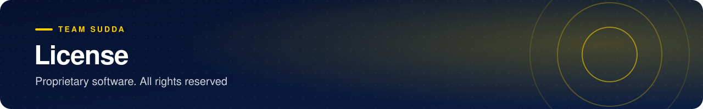

<a id="top"></a>

<div align="center">



<br/>

<p><strong>Copyright © 2026 Tank Sudda (Pvt) Ltd. All rights reserved.</strong></p>

<a href="README.md"></a>
<a href="CONTRIBUTING.md"></a>
<a href="CODE_OF_CONDUCT.md"></a>
<a href="SECURITY.md"></a>
<a href="CHANGELOG.md"></a>
<a href="LICENSE.md"></a>

</div>

---

> [!IMPORTANT]
> This is proprietary software. Viewing the source code does not grant any right to use it.

<table>
<tr>
<th width="50%">Without written permission, you may not</th>
<th width="50%">To request permission</th>
</tr>
<tr>
<td valign="top">
<ul>
<li>use, copy or modify the software</li>
<li>merge, publish or distribute it</li>
<li>sublicense or sell it</li>
<li>exploit it in whole or in part</li>
</ul>
</td>
<td valign="top">
Contact <a href="mailto:hello@teamsudda.lk">hello@teamsudda.lk</a> describing the intended use. Any permission is granted only in writing by Tank Sudda (Pvt) Ltd.
</td>
</tr>
</table>

## Licence terms

```text
Copyright (c) 2026 Tank Sudda (Pvt) Ltd. All rights reserved.

This software and its source code, including all associated files, designs,
text, images and documentation (the "Software"), are the proprietary and
confidential property of Tank Sudda (Pvt) Ltd.

No part of the Software may be used, copied, modified, merged, published,
distributed, sublicensed, sold or otherwise exploited, in whole or in part,
without the prior written permission of Tank Sudda (Pvt) Ltd.

Access to this repository does not grant any licence or right in the
Software, except as expressly agreed in writing by Tank Sudda (Pvt) Ltd.

THE SOFTWARE IS PROVIDED "AS IS", WITHOUT WARRANTY OF ANY KIND, EXPRESS OR
IMPLIED, INCLUDING BUT NOT LIMITED TO THE WARRANTIES OF MERCHANTABILITY,
FITNESS FOR A PARTICULAR PURPOSE AND NONINFRINGEMENT. IN NO EVENT SHALL THE
COPYRIGHT HOLDER BE LIABLE FOR ANY CLAIM, DAMAGES OR OTHER LIABILITY ARISING
FROM, OUT OF OR IN CONNECTION WITH THE SOFTWARE OR ITS USE.
```
