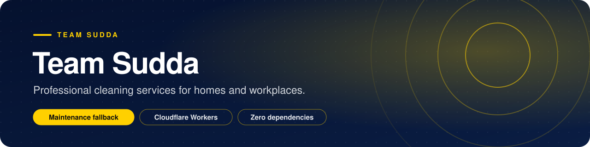
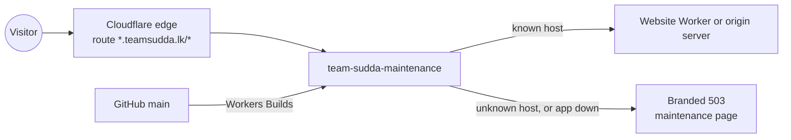
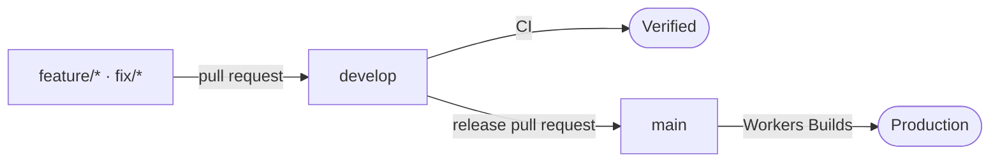

<a id="readme-top"></a>

<div align="center">



<br/>

<p><strong>The branded maintenance fallback for teamsudda.lk: a clear "Sorry, we're under maintenance" page instead of a Cloudflare error, for mistyped subdomains and for apps whose server is down.</strong></p>

<a href="https://github.com/saadmaz/Team-Sudda-Maintenance/releases"></a>
<a href="https://github.com/saadmaz/Team-Sudda-Maintenance/actions/workflows/ci.yml"></a>
<a href="https://github.com/saadmaz/Team-Sudda-Maintenance/deployments"></a>
<a href="https://github.com/saadmaz/Team-Sudda-Maintenance/commits/develop"></a>


<br/>

<a href="https://www.teamsudda.lk"></a>
<a href="docs/README.md"></a>
<a href="https://github.com/saadmaz/Team-Sudda-Maintenance/issues/new?template=bug_report.yml"></a>
<a href="https://github.com/saadmaz/Team-Sudda-Maintenance/issues/new?template=feature_request.yml"></a>

<br/>

<a href="#about">About</a> ·
<a href="#features">Features</a> ·
<a href="#architecture">Architecture</a> ·
<a href="#getting-started">Getting started</a> ·
<a href="#deployment">Deployment</a> ·
<a href="#documentation">Documentation</a> ·
<a href="#contributing">Contributing</a>

</div>

---

<details>
<summary><strong>Table of contents</strong></summary>

1. [About](#about)
2. [Features](#features)
3. [Architecture](#architecture)
4. [Tech stack](#tech-stack)
5. [Getting started](#getting-started)
6. [Configuration](#configuration)
7. [Project structure](#project-structure)
8. [Quality checks](#quality-checks)
9. [Deployment](#deployment)
10. [Documentation](#documentation)
11. [Releases and versioning](#releases-and-versioning)
12. [Contributing](#contributing)
13. [Security](#security)
14. [License](#license)

</details>

## About

`team-sudda-maintenance` is a Cloudflare Worker on the route `*.teamsudda.lk/*`. Every proxied hostname on the zone that is not served by another Worker reaches it, and it decides what that visitor sees: a redirect, the real app, or the branded maintenance page. Nobody on teamsudda.lk ever lands on Cloudflare's default "nothing here yet" page or a 52x error.

| At a glance      |                                                 |
| ---------------- | ----------------------------------------------- |
| **Organisation** | Tank Sudda (Pvt) Ltd                            |
| **Status**       | Live                                            |
| **Covers**       | `*.teamsudda.lk`                                |
| **Worker**       | `team-sudda-maintenance`                        |
| **Contact**      | [hello@teamsudda.lk](mailto:hello@teamsudda.lk) |
| **Maintainer**   | [Saad Mazhar](https://github.com/saadmaz)       |

<p align="right"><a href="#readme-top">Back to top ↑</a></p>

## Features

<table>
<tr><td width="50%" valign="top"><strong>No dead ends</strong><br/>Mistyped or retired subdomains get a branded 503 page with a retry button and a link home, instead of a Cloudflare error.</td><td width="50%" valign="top"><strong>Site safety net</strong><br/><code>www</code> and <code>dev</code> are handed to the website Workers; if one fails, visitors see the maintenance page.</td></tr>
<tr><td width="50%" valign="top"><strong>API-aware</strong><br/>Requests that want JSON get <code>{"error":"maintenance"}</code> with a 503, so apps can show their own message.</td><td width="50%" valign="top"><strong>Search-engine safe</strong><br/><code>503</code>, <code>Retry-After: 300</code>, <code>Cache-Control: no-store</code> and <code>X-Robots-Tag: noindex</code>, so outages are never cached or indexed.</td></tr>
<tr><td width="50%" valign="top"><strong>Traceable</strong><br/>Every response the Worker shapes carries <code>X-Team-Sudda-Fallback</code>, naming the branch that answered.</td><td width="50%" valign="top"><strong>Zero dependencies</strong><br/>One file of web-standard JavaScript with the page inlined. Nothing to fetch, nothing to break.</td></tr>
</table>

<p align="right"><a href="#readme-top">Back to top ↑</a></p>

## Architecture



| Host                        | What happens                                                                                                                                     | `X-Team-Sudda-Fallback`                                                 |
| --------------------------- | ------------------------------------------------------------------------------------------------------------------------------------------------ | ----------------------------------------------------------------------- |
| `www.teamsudda.lk`          | Passed to `team-sudda-website` through the `SITE` service binding. Maintenance page if that Worker throws, times out or returns a gateway error. | `service`, `service-<status>`, `service-timeout`, `service-unreachable` |
| `dev.teamsudda.lk`          | Passed to `team-sudda-website-dev` through the `SITE_DEV` service binding, with the same fallback.                                               | as above                                                                |
| Any other proxied subdomain | 503 maintenance page (JSON for API requests)                                                                                                     | `unknown-host`                                                          |

DNS-only (grey cloud) records bypass Cloudflare and never reach this Worker.

> [!TIP]
> The full request flow is in [docs/ARCHITECTURE.md](docs/ARCHITECTURE.md). Significant decisions are recorded as [architecture decision records](docs/adr/README.md).

<p align="right"><a href="#readme-top">Back to top ↑</a></p>

## Tech stack

<p>


</p>

<details>
<summary><strong>Full stack breakdown</strong></summary>

| Layer    | Technology                                                   |
| -------- | ------------------------------------------------------------ |
| Runtime  | Cloudflare Workers, ES module syntax, web-standard APIs only |
| Language | JavaScript, no build step                                    |
| Hosting  | Cloudflare, as a zone route on `*.teamsudda.lk/*`            |
| Tooling  | Bun, Wrangler, Prettier, Node.js for the tests               |

</details>

<p align="right"><a href="#readme-top">Back to top ↑</a></p>

## Getting started

### Prerequisites

- [Bun](https://bun.sh) 1.4 or later
- Node.js 22 or later

### Install and run

```sh
git clone https://github.com/saadmaz/Team-Sudda-Maintenance.git
cd Team-Sudda-Maintenance
bun install
bun run dev
```

The Worker runs at **http://localhost:8787**. Locally every request arrives as `localhost`, so it shows the maintenance page; the per-host behaviour is covered by the tests.

<details>
<summary><strong>All scripts</strong></summary>

| Command                           | Description                                                       |
| --------------------------------- | ----------------------------------------------------------------- |
| `bun run dev`                     | Run the Worker locally in Cloudflare's runtime                    |
| `bun run test`                    | Run the tests in `test/`                                          |
| `bun run check`                   | Bundle the Worker without deploying (`wrangler deploy --dry-run`) |
| `bun run format` / `format:check` | Format with Prettier, or check without writing                    |
| `bun run deploy`                  | Deploy from your machine (normally Workers Builds does this)      |

</details>

<p align="right"><a href="#readme-top">Back to top ↑</a></p>

## Configuration

The Worker needs no environment variables or secrets. Host handling lives in the constants at the top of `src/index.js`; the route, bindings and Worker settings live in `wrangler.jsonc`.

<details>
<summary><strong>Configuration files</strong></summary>

| File             | Controls                                                                               |
| ---------------- | -------------------------------------------------------------------------------------- |
| `src/index.js`   | Which hosts redirect, pass through or get the page; the page itself                    |
| `wrangler.jsonc` | Worker name, compatibility date, the `*.teamsudda.lk/*` route, bindings, observability |

Where each value is set, and how to add a new app: [docs/CONFIGURATION.md](docs/CONFIGURATION.md).

</details>

> [!IMPORTANT]
> When a new app goes live on a proxied subdomain of teamsudda.lk, add it to `src/index.js` in the same release, or the route answers it with the maintenance page.

<p align="right"><a href="#readme-top">Back to top ↑</a></p>

## Project structure

<details>
<summary><strong>Repository layout</strong></summary>

```
.
├── .github/              # CI and Deploy workflows, issue and pull request templates
├── docs/                 # Architecture, configuration, deployment, ADRs and runbooks
├── src/index.js          # The Worker: host routing and the inlined maintenance page
├── test/index.test.mjs   # Behaviour tests, run with Node.js
└── wrangler.jsonc        # Cloudflare Worker and route configuration
```

</details>

<p align="right"><a href="#readme-top">Back to top ↑</a></p>

## Quality checks

Every pull request into `develop` or `main` runs the [CI workflow](.github/workflows/ci.yml): formatting, tests and a dry-run bundle of the Worker. Pull requests merge only when CI is green.

```sh
bun run format:check && bun run test && bun run check
```

> [!IMPORTANT]
> Run the same checks locally before opening a pull request. They are the exact commands CI runs.

<p align="right"><a href="#readme-top">Back to top ↑</a></p>

## Deployment

| Environment | Branch    | URL                               | Status                                                                                                                                                                |
| ----------- | --------- | --------------------------------- | --------------------------------------------------------------------------------------------------------------------------------------------------------------------- |
| Development | `develop` | None: built and tested by CI only |                                   |
| Production  | `main`    | `*.teamsudda.lk`                  |  |



Cloudflare Workers Builds deploys every push to `main`; the Deploy workflow waits for that build and then checks that https://www.teamsudda.lk/ is answered by this Worker. A route Worker has no separate development copy, so `develop` is verified by CI only. Setup and post-deployment checks are in [docs/DEPLOYMENT.md](docs/DEPLOYMENT.md).

> [!TIP]
> To ship or undo a release, follow the [release](docs/runbooks/release.md) and [rollback](docs/runbooks/rollback.md) runbooks.

<p align="right"><a href="#readme-top">Back to top ↑</a></p>

## Documentation

Every STTPS repository uses the same documentation layout.

| Document                               | Covers                                         |
| -------------------------------------- | ---------------------------------------------- |
| [Documentation index](docs/README.md)  | Every document in this repository              |
| [Architecture](docs/ARCHITECTURE.md)   | How requests are routed and answered           |
| [Configuration](docs/CONFIGURATION.md) | Host lists, bindings and configuration files   |
| [Deployment](docs/DEPLOYMENT.md)       | Hosting, pipeline, first-time setup and checks |
| [Content](docs/CONTENT.md)             | Updating the page's copy, colours and logo     |
| [Decision records](docs/adr/README.md) | Why the system is built the way it is          |
| [Runbooks](docs/runbooks/README.md)    | Release and rollback procedures                |

<p align="right"><a href="#readme-top">Back to top ↑</a></p>

## Releases and versioning

[](https://github.com/saadmaz/Team-Sudda-Maintenance/releases)

The project follows [Semantic Versioning](https://semver.org). Every release is tagged `vX.Y.Z`, published on the [Releases](https://github.com/saadmaz/Team-Sudda-Maintenance/releases) page with its notes, and recorded in [CHANGELOG.md](CHANGELOG.md). The procedure is in [docs/runbooks/release.md](docs/runbooks/release.md).

<p align="right"><a href="#readme-top">Back to top ↑</a></p>

## Contributing

| Step |                                                                           |
| ---- | ------------------------------------------------------------------------- |
| 1    | Branch from `develop` using a type prefix (`feat/`, `fix/`, `docs/`, ...) |
| 2    | Commit with [Conventional Commits](https://www.conventionalcommits.org)   |
| 3    | Open a pull request into `develop` and complete the checklist             |
| 4    | Squash and merge once CI is green and the change is reviewed              |

The full guide is in [CONTRIBUTING.md](CONTRIBUTING.md). Everyone taking part follows the [Code of Conduct](CODE_OF_CONDUCT.md).

<p align="right"><a href="#readme-top">Back to top ↑</a></p>

## Security

> [!IMPORTANT]
> Never report a vulnerability in a public issue. Follow [SECURITY.md](SECURITY.md) to report it privately; you will hear back within three business days.

<p align="right"><a href="#readme-top">Back to top ↑</a></p>

## License

Copyright © 2026 Tank Sudda (Pvt) Ltd. All rights reserved.

This is proprietary software. No permission is granted to use, copy, modify or distribute it without prior written consent. See [LICENSE](LICENSE.md).

<div align="center">
<br/>
<sub>Built and maintained by the Tank Sudda team · Part of the <a href="https://sttps.co">STTPS group</a></sub>
</div>
