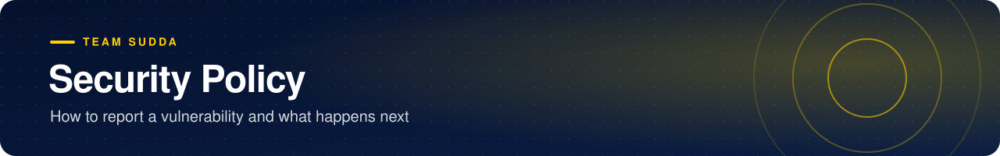
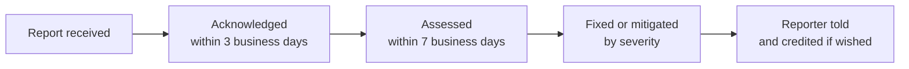

 

<strong>We take the security of the teamsudda.lk maintenance fallback and the people who use it seriously. Thank you for helping keep them safe.</strong>

---

> [!CAUTION]
> Never report a security problem in a public issue, pull request or discussion. Report it privately as described below.

## Reporting a vulnerability

|              |                                                                                                                                                                                                                                            |
| ------------ | ------------------------------------------------------------------------------------------------------------------------------------------------------------------------------------------------------------------------------------------ |
| **Email**    | [hello@teamsudda.lk](mailto:hello@teamsudda.lk?subject=Security%20report) with the subject line `Security report` or GitHub's [private vulnerability reporting](https://github.com/saadmaz/Team-Sudda-Maintenance/security/advisories/new) |
| **Include**  | What the issue is and its impact · the affected URL, screen, endpoint or file · steps to reproduce or a proof of concept · any suggested fix                                                                                               |
| **Language** | English                                                                                                                                                                                                                                    |

<a href="#top">Back to top ↑</a>

## What happens next

| Stage              | Target                                                     |
| ------------------ | ---------------------------------------------------------- |
| Acknowledgement    | Within **3 business days**                                 |
| Initial assessment | Within **7 business days**                                 |
| Fix or mitigation  | Based on severity; critical issues are handled immediately |

We keep you informed throughout and tell you when the issue is resolved.

<a href="#top">Back to top ↑</a>

## Supported versions

| Version                                          | Supported |
| ------------------------------------------------ | :-------: |
| Latest release on `main`, deployed to production |    Yes    |
| Older releases                                   |    No     |

<a href="#top">Back to top ↑</a>

## Scope

<table>
<tr>
<th width="50%">In scope</th>
<th width="50%">Out of scope</th>
</tr>
<tr>
<td valign="top">
<ul>
<li>teamsudda.lk and its subdomains</li>
<li>the maintenance page and every response this Worker sends</li>
<li>the source code in this repository</li>
</ul>
</td>
<td valign="top">
<ul>
<li>denial-of-service and volumetric attacks</li>
<li>social engineering of Team Sudda staff or customers</li>
<li>automated scanner findings without a demonstrated impact</li>
<li>third-party services such as Cloudflare, Firebase or the hosting provider (report those to the provider)</li>
</ul>
</td>
</tr>
</table>

<a href="#top">Back to top ↑</a>

## Handling secrets

> [!IMPORTANT]
> Credentials, API keys and service-account files are never committed to this repository. They live in the hosting provider's secret store or in GitHub Environments. If you find a secret in the code or its history, report it as a vulnerability.

<a href="#top">Back to top ↑</a>

## Safe harbour

> [!NOTE]
> We will not pursue action against anyone who reports a vulnerability in good faith, avoids privacy violations and service disruption, does not access or modify other people's data, and gives us reasonable time to fix the issue before disclosing it.
