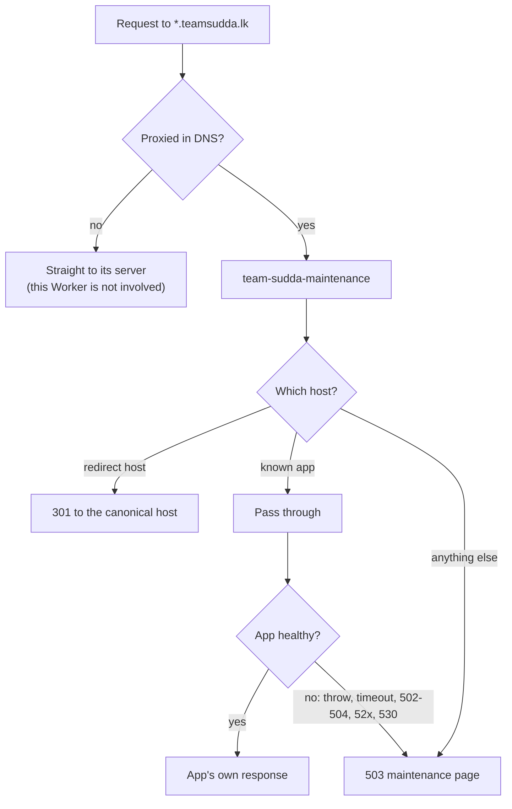

# Architecture

<!-- nav -->

<a href="../README.md">Project README</a> · <a href="README.md">Documentation index</a>

> How `team-sudda-maintenance` decides what a visitor on teamsudda.lk sees. Part of the [project documentation](README.md).

## Where it sits

The Worker is attached to the zone route `*.teamsudda.lk/*`. Cloudflare sends it every request for a **proxied** (orange cloud) hostname on the zone, except hostnames that are custom domains of another Worker and win over the route. DNS-only (grey cloud) records go straight to their server and never reach it.

## Hosts

| Host                        | What happens                                                                                                                                     | `X-Team-Sudda-Fallback`                                                 |
| --------------------------- | ------------------------------------------------------------------------------------------------------------------------------------------------ | ----------------------------------------------------------------------- |
| `www.teamsudda.lk`          | Passed to `team-sudda-website` through the `SITE` service binding. Maintenance page if that Worker throws, times out or returns a gateway error. | `service`, `service-<status>`, `service-timeout`, `service-unreachable` |
| `dev.teamsudda.lk`          | Passed to `team-sudda-website-dev` through the `SITE_DEV` service binding, with the same fallback.                                               | as above                                                                |
| Any other proxied subdomain | 503 maintenance page (JSON for API requests)                                                                                                     | `unknown-host`                                                          |

## Responses

| Case                                                 | Status | Body                                                                           |
| ---------------------------------------------------- | :----: | ------------------------------------------------------------------------------ |
| Browser (`GET`/`HEAD`, not JSON-only)                |  503   | The branded HTML page (empty for `HEAD`)                                       |
| API or asset request (wants JSON, or a write method) |  503   | `{"error":"maintenance","message":"This service is temporarily unavailable."}` |
| Redirect host                                        |  301   | None; `Location` keeps the path and query                                      |
| Healthy pass-through                                 | App's  | The app's own response, unchanged                                              |

Every maintenance response sends `Retry-After: 300`, `Cache-Control: no-store` and `X-Robots-Tag: noindex`, so search engines treat the outage as temporary and nothing is cached.

Pass-through requests are given **25 seconds** (`ORIGIN_TIMEOUT_MS`). A status in `DOWN_STATUSES` (502, 503, 504, 520 to 527, 530) is treated as "down" and replaced by the maintenance page; any other status, including 404 and 500, is passed through as the app sent it.

## Design constraints

- **No dependencies, no build step.** The page, its styles, the logo mark and the favicon are inlined in `src/index.js`. Nothing is fetched to render it, so it works when every other system is down.
- **One file of logic.** Host lists are plain constants at the top of `src/index.js`, reviewed in pull requests like any other change.
- **Universal SSL covers one level.** Only `<name>.teamsudda.lk` can be proxied; `a.b.teamsudda.lk` must stay DNS-only or the TLS handshake fails before the Worker runs.
